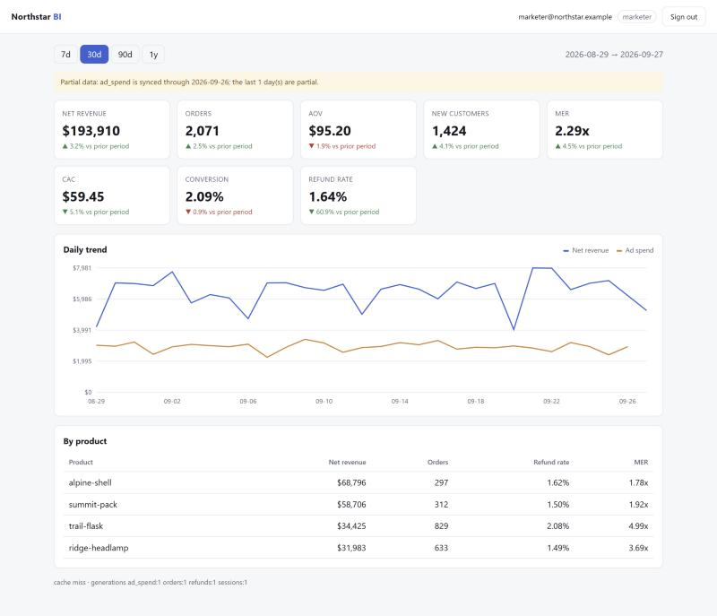

# Semantic BI Dashboard

A small, production-shaped BI service: a closed-vocabulary semantic layer
over a warehouse, resource-based permissions, local session auth, a
generation-keyed cache, per-source freshness, a read-only partner API, and
a dependency-free dashboard UI.

The data belongs to a fictional DTC brand, **Northstar Outfitters**, and is
generated from a fixed seed. There is no employer code, credential,
customer, or internal domain in this repository.



## The problems it is built around

Dashboards rarely fail by crashing. They fail by showing a plausible
wrong number. Each of these is a real way that happens, and each is
handled in code and covered by a test:

| Failure | What this service does |
|---|---|
| Joining orders to ad spend fans rows out and multiplies revenue | One query per fact table, merged on `(bucket, dimensions)` |
| Weekly MER shown as the average of seven daily MERs | Ratios are computed from sums, after aggregation, including the totals row |
| "Conversion by product" when sessions have no product | Refused with the reason instead of dividing by all sessions |
| Net revenue from a stale `order.refunded` snapshot | Refunds come from the complete ledger, attributed to order date |
| Last day of the chart shows spend "dropping to zero" | Days past a source's sync are `null`, and the line lifts its pen |
| "Last 7 days" compares 7 days of spend with 5 days of revenue | Every response names which source is behind and by how many days |
| Cache serves yesterday's numbers after a sync | Cache keys include per-source generations; syncs make old keys unreachable |
| A viewer backs out ad spend from MER | Derived metrics need permission on every input |
| A partner integration breaks when a field is renamed | `/v1` is versioned, fixed-field, and read-only |

## Architecture

```text
Browser (vanilla JS, strict CSP)          Partner system
   │ HttpOnly session + CSRF header          │ X-API-Key (hashed, scoped)
   ▼                                          ▼
/api/*  ── session auth ── RBAC        /v1/* ── key scope ── rate limit
   └──────────────┬────────────────────────────┘
                  ▼
              Engine
   generation cache ──► semantic layer ──► SQLite warehouse
                           │ parse → validate → compile per fact
                           │ merge → derive → null past sync
                           ▼
                     freshness metadata
```

The design reasoning is in [ARCHITECTURE.md](ARCHITECTURE.md).

## Run locally

```bash
python -m venv .venv
# Windows: .venv\Scripts\activate
# Unix: source .venv/bin/activate
pip install -r requirements-dev.txt
pytest
uvicorn app.main:app --reload --port 8080
```

Open <http://localhost:8080> and sign in with one of the seeded demo
accounts. The password is `DEMO_PASSWORD` from `.env.example`.

| Email | Role | Sees |
|---|---|---|
| `owner@northstar.example` | admin | everything, plus user management |
| `marketer@northstar.example` | marketer | overview, marketing, traffic |
| `viewer@northstar.example` | viewer | overview only (no spend, MER, or CAC) |

Demo accounts and demo API keys are created only when `ENVIRONMENT` is not
`production`.

```bash
docker compose up --build
```

## API

Dashboard (`/api`, session cookie; mutations also need `X-CSRF-Token`):

| Method | Path | Notes |
|---|---|---|
| POST | `/api/auth/login` | Sets `nbi_session` (HttpOnly) and `nbi_csrf` |
| POST | `/api/auth/logout` | Server-side session delete |
| POST | `/api/auth/activate` | One-time invite token + new password |
| GET | `/api/me` | Role, resources, capabilities |
| GET | `/api/v1/catalog` | Metrics the caller may read, with units and dimensions |
| POST | `/api/v1/query` | `metrics`, dates, `grain`, `group_by`, `filters` |
| POST | `/api/v1/comparison` | Current vs `previous_period` / `previous_year` |
| POST | `/api/v1/dashboard/overview` | Tiles, daily series, product table in one call |
| GET | `/api/admin/users` | Admin only |
| POST | `/api/admin/users/invite` | Returns a one-time activation token |
| POST | `/api/admin/users/revoke` | Ends that user's live sessions immediately |
| POST | `/api/admin/sync` | Simulates a finished sync (bumps generation) |

Partner (`/v1`, `X-API-Key`):

```bash
curl -s "http://localhost:8080/v1/revenue?start_date=2026-09-01&end_date=2026-09-27" \
  -H "x-api-key: demo-finance-key"
```

| Path | Fields | Scope |
|---|---|---|
| `/v1/revenue` | gross, refunds, net, orders per day | overview |
| `/v1/ad-spend` | spend, MER, CAC per day | overview + marketing |

A query through the dashboard:

```bash
curl -s localhost:8080/api/v1/query -b cookies.txt \
  -H "content-type: application/json" \
  -d '{"metrics":["net_revenue","mer"],"start_date":"2026-09-01","end_date":"2026-09-27",
       "grain":"week","group_by":["channel"]}'
```

## Where to read the code

- `app/semantic.py`: vocabulary, per-fact compilation, merge, ratio-of-sums, null past sync
- `app/warehouse.py`: why there is a refund ledger *and* a stale snapshot
- `app/cache.py`: generation keys instead of invalidation scans
- `app/freshness.py`: what "complete" means for a multi-source query
- `app/authz.py`: resources, not metric-name prefixes; derived metrics inherit restrictions
- `app/auth.py`: hashed session tokens, idle and absolute expiry, lockout, uniform errors
- `app/external_api.py`: a versioned contract for someone else's code
- `app/static/app.js`: no `innerHTML` with data, so the CSP means something

## Tests

`pytest` needs no database server, network, or keys. The suite covers
contract rejection (including an injection attempt), bound parameters, no
fan-out, ratio-of-sums, Monday weeks, ledger vs. snapshot refunds, late
refund restatement, null past sync, freshness warnings, cache hit, targeted
invalidation, TTL and LRU, session hashing, idle and absolute expiry,
lockout, uniform login errors, invite single use, CSRF, RBAC on derived
metrics, revoke ending live sessions, API key scope, rate limit, and that
the partner API matches the dashboard to the cent.

## License

MIT. See [LICENSE](LICENSE).
